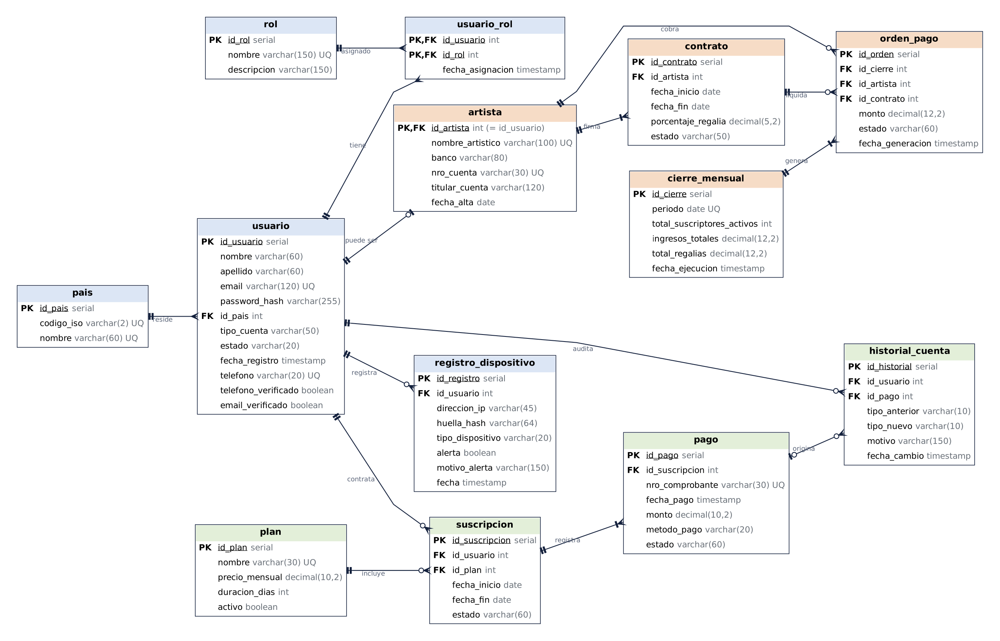

# A&J Music – Base de datos transaccional (OLTP)

Proyecto de **Base de Datos II** - Ingenieria de Sistemas - Universidad Catolica Boliviana (UCB)

A&J Music es una plataforma boliviana de musica. Este repositorio contiene su base de datos
transaccional en **PostgreSQL**: la unica fuente de verdad para **identidades y dinero** (usuarios, roles,
suscripciones, pagos, contratos y regalias).



## Contenido

| Elemento | Cantidad | Detalle |
| --- | --- | --- |
| Tablas | 13 | Identidades, dinero que entra, dinero que sale |
| Funciones | 3 | `fn_calcular_regalia`, `fn_ingresos_del_mes`, `fn_cuentas_por_dispositivo` |
| Triggers | 2 | `trg_pago_fallido`, `trg_control_registro` |
| Procedimientos | 3 | `sp_registrar_usuario`, `sp_convertir_en_artista`, `sp_cierre_mensual` |
| Vistas de negocio | 4 | Ingresos por plan, regalías por artista, pagos fallidos, registros con alerta |

## Estructura del repositorio

```
ajmusic-bd/
├── README.md                          ← este archivo
├── sql/
│   ├── 01_tablas.sql                  ← esquema, tablas, restricciones, datos y pruebas de error
│   └── 02_funciones_procedimientos.sql ← funciones, triggers, procedimientos, vistas y demostración
├── diagramas/
│   ├── ajmusic_modelo_er.drawio       ← diagrama editable (draw.io)
│   └── ajmusic_modelo_er.png          ← diagrama en imagen
└── docs/
    └── (manual técnico en PDF/Word y presentación)
```

## Cómo ejecutarlo en pgAdmin 4

1. Clic derecho en **Databases → Create → Database** y crear `ajmusic`.
2. Clic derecho en `ajmusic` → **Query Tool**.
3. Abrir `sql/01_tablas.sql` y ejecutar todo con **F5**.
4. Abrir `sql/02_funciones_procedimientos.sql`. Ejecutar las secciones 1 a 4 (funciones, triggers,
   procedimientos y vistas) y luego la sección 5 **paso por paso**, seleccionando cada bloque y presionando F5.
5. Ver los objetos en **ajmusic → Schemas → oltp**.

Para reiniciar la demostracion, volver a ejecutar `01_tablas.sql` (borra y recrea todo) y despues `02`.

## Reglas de negocio que hace cumplir la base

- **Un numero de celular = un perfil** (`telefono` UNIQUE y `sp_registrar_usuario`).
- Maximo **2 cuentas por dispositivo**; la IP compartida solo genera **alerta** (`trg_control_registro`).
- Una sola suscripcion **activa** por usuario y un solo contrato **vigente** por artista.
- Un **pago fallido** baja la cuenta a Free sin borrar al usuario (`trg_pago_fallido`).
- Un mes **no se cierra dos veces** y un artista **no cobra dos veces** el mismo mes.
- Un usuario con historial **nunca se elimina**.

## Cronograma de defensas

| Defensa | Fecha |
| --- | --- |
| Modelo transaccional (ER) | 03/11/2026 |
| Procedimientos y funciones | 10/11/2026 |
| Data Warehouse | 17/11/2026 |
| NoSQL | 24/11/2026 |

## Equipo

| Rol | Integrante |
| --- | --- |
| Lider del proyecto | [Joseph Cortez] |
| Desarrollador de base de datos | [Joseph Cortez] |
| Tester | [Alan Ticona] |
| Documentacion y analisis | [Alan Ticona] |
